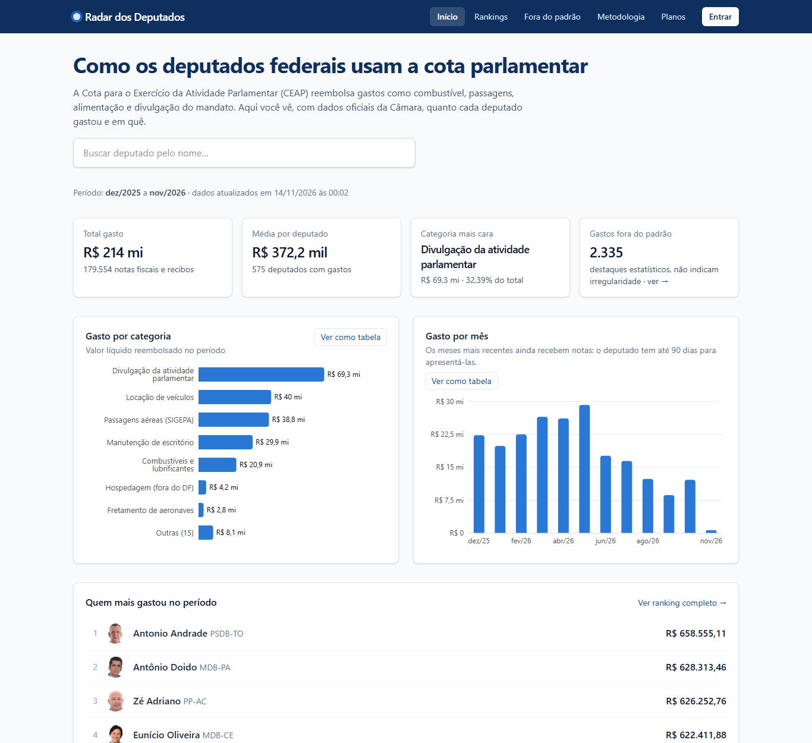
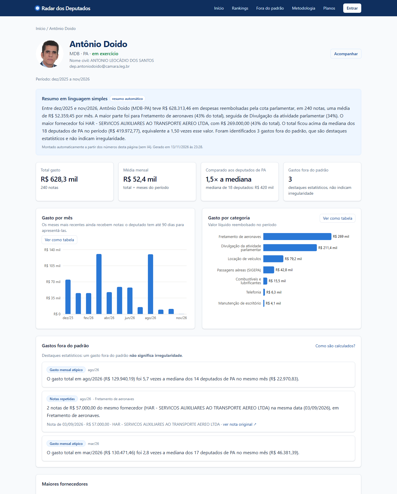
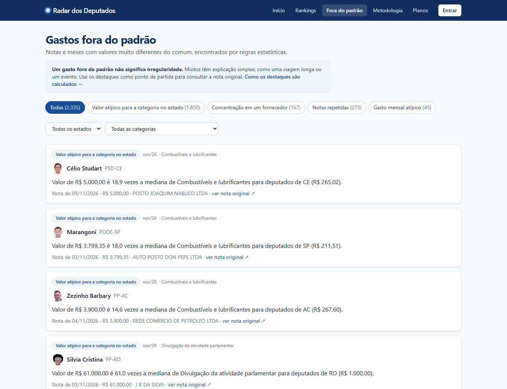
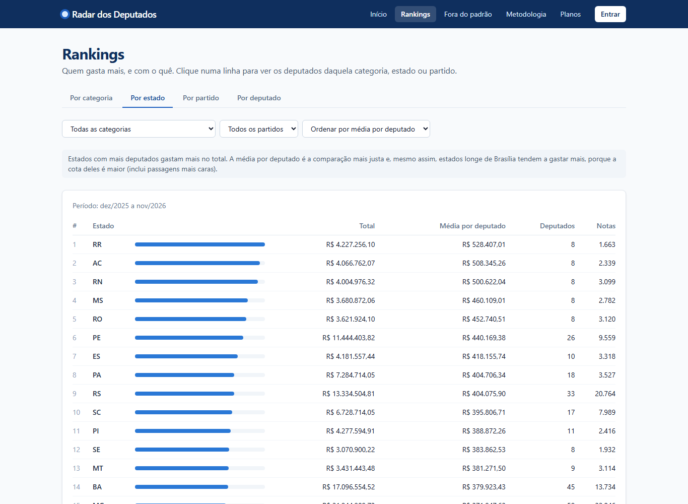
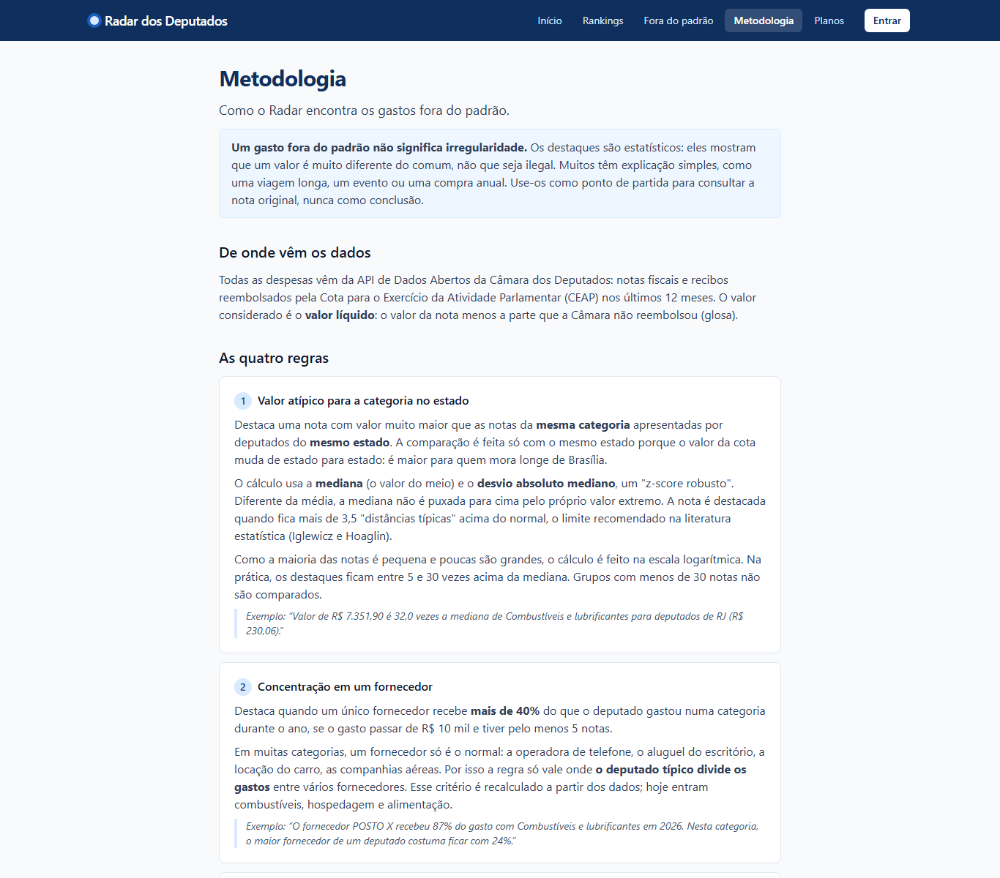
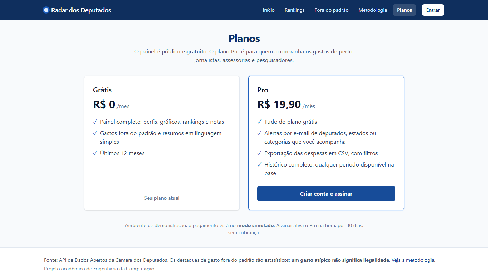
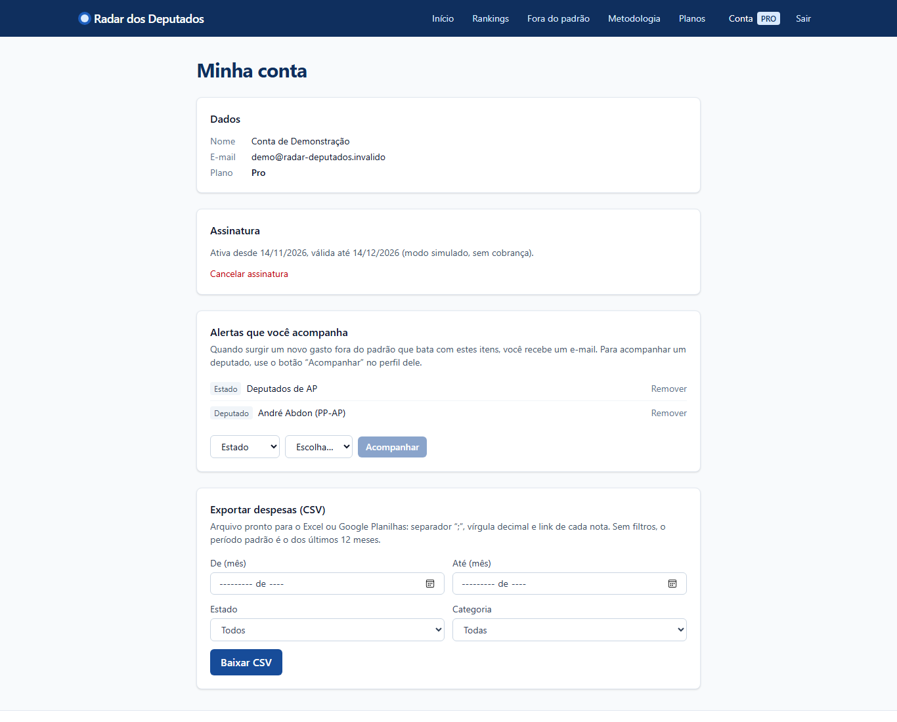
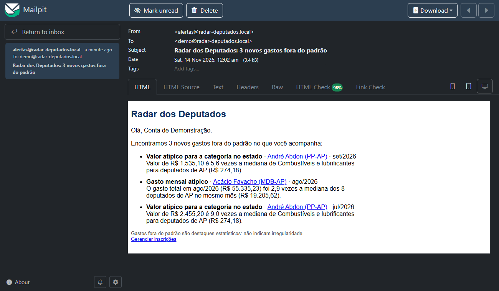
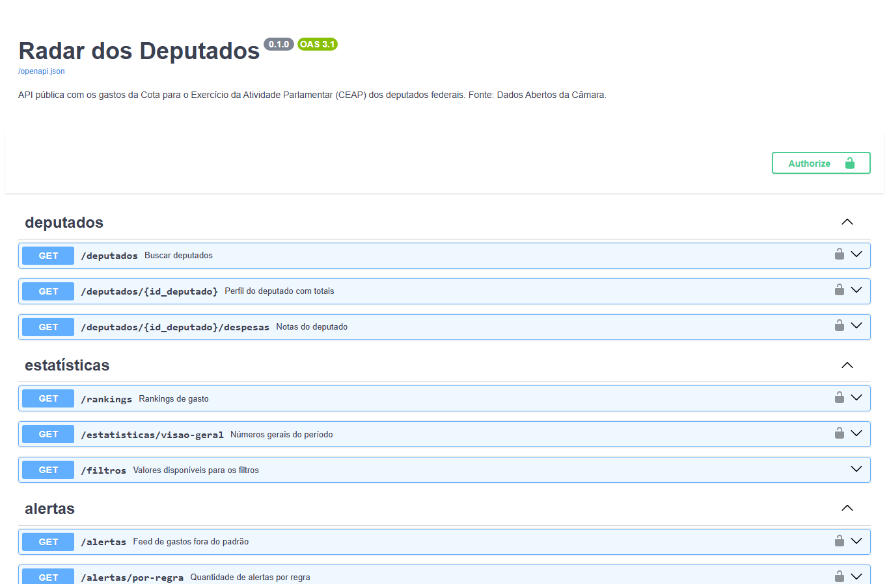

# Radar dos Deputados

Painel web público que mostra como os deputados federais gastam a **Cota para o Exercício da Atividade Parlamentar (CEAP)**: combustível, passagens, alimentação, divulgação e mais. O sistema:

- **destaca gastos fora do padrão** com regras estatísticas;
- **resume os gastos de cada deputado em linguagem simples**, com IA;
- oferece um **plano Pro** com alertas por e-mail e exportação de dados, para jornalistas, assessorias e pesquisadores.

Fonte única de dados: [API de Dados Abertos da Câmara dos Deputados](https://dadosabertos.camara.leg.br/swagger/api.html).

> **Um gasto fora do padrão não significa irregularidade.** Os destaques são estatísticos e servem para orientar a consulta. Ver [docs/metodologia.md](docs/metodologia.md).



---

## Sumário

1. [Funcionalidades](#funcionalidades)
2. [Como rodar (do zero)](#como-rodar-do-zero)
3. [Comandos do dia a dia](#comandos-do-dia-a-dia)
4. [Plano Pro: como testar](#plano-pro-como-testar)
5. [Resumos com IA](#resumos-com-ia)
6. [Alertas por e-mail e agendamento](#alertas-por-e-mail-e-agendamento)
7. [API](#api)
8. [Variáveis de ambiente](#variáveis-de-ambiente)
9. [Testes e qualidade](#testes-e-qualidade)
10. [Estrutura do repositório](#estrutura-do-repositório)
11. [Telas](#telas)
12. [Documentação](#documentação)

---

## Funcionalidades

| | Grátis | Pro (R$ 19,90/mês) |
|---|:---:|:---:|
| Busca de deputado, perfil com gráficos, notas com link do documento | ✅ | ✅ |
| Rankings por categoria, estado, partido e deputado | ✅ | ✅ |
| Gastos fora do padrão (4 regras estatísticas) | ✅ | ✅ |
| Resumo de cada deputado em linguagem simples | ✅ | ✅ |
| Período consultado | últimos 12 meses | histórico completo |
| Exportação das despesas em CSV, com filtros | — | ✅ |
| Alertas por e-mail de deputados, estados ou categorias que você acompanha | — | ✅ |

## Como rodar (do zero)

**Pré-requisitos:**
- [Docker Desktop](https://www.docker.com/products/docker-desktop/) instalado e aberto;
- internet, para baixar as imagens e os dados da Câmara;
- livres no computador: 5 GB de disco e as portas 5173, 8000, 5432, 8025 e 1025.

```bash
# 1. Entre na pasta do projeto e crie o arquivo de configuração
cd radar-deputados
cp .env.example .env
#    (recomendado) troque JWT_SEGREDO no .env por um valor aleatório:
#    python -c "import secrets; print(secrets.token_urlsafe(48))"

# 2. Suba tudo: banco, API, site, agendador e caixa de e-mails de teste
#    (a primeira vez demora alguns minutos para baixar e montar as imagens)
docker compose up --build -d

# 3. Carregue os dados reais da Câmara: 12 meses, ~180 mil notas (~9 minutos)
docker compose exec api python -m app.etl carga-inicial

# 4. Calcule os gastos fora do padrão (~10 s) e gere os resumos (~10 s)
docker compose exec api python -m app.etl recalcular-alertas
docker compose exec api python -m app.etl gerar-resumos
```

Pronto. Abra:

| O quê | Endereço |
|---|---|
| **Site** | http://localhost:5173 |
| Documentação da API (Swagger) | http://localhost:8000/docs |
| Caixa de e-mails de teste (Mailpit) | http://localhost:8025 |
| Banco (DBeaver/pgAdmin) | `localhost:5432`, usuário e senha do `.env` |

> **Para testar mais rápido:** troque o passo 3 por `docker compose exec api python -m app.etl carga-inicial --meses 2 --uf AP` (~2 minutos na primeira vez, só o Amapá).

As tabelas do banco são criadas sozinhas quando a API sobe (`alembic upgrade head`). Para parar, use `docker compose down`; os dados ficam no volume `dados_postgres`. Para apagar tudo, inclusive os dados, use `docker compose down -v`.

## Comandos do dia a dia

```bash
# Dados (ETL). Rodar de novo não duplica nada; cada execução fica na tabela execucoes_etl.
docker compose exec api python -m app.etl carga-inicial          # 12 meses (--meses N, --uf XX, --limite-deputados N)
docker compose exec api python -m app.etl atualizar              # só o mês atual e o anterior (~1,5 min)
docker compose exec api python -m app.etl recalcular-alertas     # 4 regras + e-mail aos inscritos (--sem-notificar)
docker compose exec api python -m app.etl gerar-resumos          # só os que faltam (--forcar, --deputado ID, --limite N)
docker compose exec api python -m app.etl ciclo-diario           # tudo na ordem (o mesmo que o agendador roda às 06:00)

# Kit de demonstração (não cria dados inventados)
docker compose exec api python -m app.demo preparar              # conta Pro de demonstração
docker compose exec api python -m app.demo simular-alertas --uf AP   # faz chegar um e-mail de alerta no Mailpit
docker compose exec api python -m app.demo limpar

# Banco
docker compose exec api alembic upgrade head                     # migrações (já é automático)
docker compose exec api alembic check                            # confere se modelos e banco batem
docker compose exec db psql -U radar -d radar                    # console SQL
```

## Plano Pro: como testar

**Modo simulado (padrão), pelo site:**
1. Abra http://localhost:5173/planos, clique em **Criar conta e assinar** e crie a conta.
2. Clique em **Assinar o Pro**. O plano vira Pro na hora, por 30 dias e sem cobrança.
3. Em **Minha conta**: baixe o CSV e escolha estados ou categorias para acompanhar.
4. No perfil de um deputado, use **Acompanhar**.
5. Cancele a assinatura. A exportação volta a responder 403.

Ou use a conta de demonstração (`python -m app.demo preparar`): `demo@radar-deputados.invalido`, senha `demonstracao123`.

**Pela API (`/docs`):**
1. `POST /auth/cadastro` e copie o `access_token`.
2. Clique em **Authorize** e cole o token.
3. `GET /export/despesas.csv` responde **403**.
4. `POST /planos/assinar`.
5. `GET /export/despesas.csv` responde **200**.

**Stripe em modo de teste (opcional):**
1. Crie uma conta em https://dashboard.stripe.com (modo de teste) e um produto com preço recorrente mensal.
2. No `.env`, configure `PAGAMENTO_MODO=stripe`, `STRIPE_SECRET_KEY=sk_test_...` e `STRIPE_PRICE_ID=price_...`.
3. Receba os webhooks localmente com a Stripe CLI: `stripe listen --forward-to localhost:8000/planos/webhook`. Copie o `whsec_...` que ela mostrar para `STRIPE_WEBHOOK_SECRET`.
4. Rode `docker compose restart api`.

Ao assinar, o site leva ao checkout do Stripe (cartão de teste `4242 4242 4242 4242`). O plano só vira Pro quando o **webhook** confirma o pagamento.

## Resumos com IA

O padrão é `LLM_PROVEDOR=template`, que monta o texto **sem IA** e funciona sem nenhuma chave. O selo do site diz "resumo automático". Para usar o Claude:

1. Crie uma chave em https://platform.claude.com e coloque no `.env`: `ANTHROPIC_API_KEY=...`.
2. Mude para `LLM_PROVEDOR=anthropic`. O modelo padrão é o `claude-opus-5-5`; para economizar, use `ANTHROPIC_MODELO=claude-haiku-5-5`.
3. Rode `docker compose restart api` e depois `docker compose exec api python -m app.etl gerar-resumos --forcar --limite 5`, para conferir antes de gerar todos.

**Como a IA é usada:**
- Recebe só números agregados (totais, categorias, maiores fornecedores, mediana do estado, alertas). Nunca as notas.
- Escreve 3 a 5 frases neutras.
- Todo número do texto é **conferido** com os dados. Se aparecer um número inventado, ou se a API falhar ou recusar, o sistema usa o template.
- O resumo é gerado uma vez e guardado no banco; nenhuma página espera o LLM.
- O selo do site diz "resumo gerado por IA" só quando foi um LLM que escreveu.

Detalhes em [docs/arquitetura.md](docs/arquitetura.md#ia-resumos-em-linguagem-simples).

## Alertas por e-mail e agendamento

Quem é Pro acompanha deputados, estados ou categorias. Depois de cada recálculo, recebe **um e-mail** com os gastos fora do padrão **novos** que batem com o que acompanha. Um alerta só é novo uma vez, então ninguém recebe o mesmo alerta duas vezes.

- Em desenvolvimento, os e-mails vão para o **Mailpit** (http://localhost:8025): nada sai para a internet. Com `EMAIL_BACKEND=console`, o e-mail aparece só no log.
- O serviço `scheduler` roda o **ciclo diário** às 06:00 (`AGENDA_HORA`): atualizar dados → recalcular alertas → enviar e-mails → gerar os resumos que faltam. Para acompanhar, use `docker compose logs -f scheduler`.
- Para ver um e-mail chegando agora, use `python -m app.demo simular-alertas --uf AP`. O comando apaga 3 alertas **reais** do estado e recalcula: eles voltam como "novos", exatamente como quando chegam notas novas.

## API

Documentação interativa: http://localhost:8000/docs. As rotas com período aceitam `?de=AAAA-MM&ate=AAAA-MM`; o padrão são os últimos 12 meses.

**Públicas:**

| Rota | Para quê |
|---|---|
| `GET /deputados` | Busca (ignora acentos), filtros por UF, partido e exercício, paginação |
| `GET /deputados/{id}` | Perfil: totais, por categoria, por mês, maiores fornecedores, comparação com a mediana do estado, resumo |
| `GET /deputados/{id}/despesas` | Notas, com link do documento original |
| `GET /deputados/{id}/alertas` | Gastos fora do padrão do deputado |
| `GET /alertas`, `GET /alertas/por-regra` | Feed de gastos fora do padrão (filtros: regra, UF, categoria) |
| `GET /rankings` | Por categoria, UF, partido ou deputado; total ou média por deputado |
| `GET /estatisticas/visao-geral`, `GET /filtros` | Números da página inicial; valores dos filtros |

**Com login** (cabeçalho `Authorization: Bearer <token>`):

| Rota | Para quê |
|---|---|
| `POST /auth/cadastro`, `POST /auth/login`, `GET /auth/me` | Conta |
| `GET /planos`, `POST /planos/assinar`, `POST /planos/cancelar` | Assinatura |
| `POST /planos/webhook` | Chamado pelo Stripe (a assinatura do evento é conferida) |
| `GET /export/despesas.csv` | **Pro.** CSV com filtros de período, UF, partido, categoria e deputado |
| `GET/POST /me/inscricoes`, `DELETE /me/inscricoes/{id}` | **Pro.** Acompanhar deputado, UF ou categoria |

## Variáveis de ambiente

Todas estão comentadas no [.env.example](.env.example). As principais:

| Variável | Padrão | Para quê |
|---|---|---|
| `POSTGRES_USER` / `POSTGRES_PASSWORD` / `POSTGRES_DB` | `radar` / `radar_dev` / `radar` | Banco |
| `POSTGRES_PORTA_HOST` | `5432` | Porta do banco no seu computador (mude se já usar a 5432) |
| `JWT_SEGREDO` | *exemplo* | Assina os tokens de login. **Troque** (a API avisa se não trocar) |
| `ETL_MESES_CARGA_INICIAL` | `12` | Meses da carga inicial |
| `ETL_PAUSA_SEGUNDOS` / `ETL_PARALELISMO` | `0.3` / `3` | Ritmo das chamadas à API da Câmara |
| `ANOMALIA_*` | ver [metodologia](docs/metodologia.md#parâmetros-atuais) | Limites das 4 regras de gasto fora do padrão |
| `LLM_PROVEDOR` | `template` | `template` (sem IA), `anthropic` ou `ollama` |
| `ANTHROPIC_API_KEY` / `ANTHROPIC_MODELO` | vazio / `claude-opus-5-5` | Claude |
| `PAGAMENTO_MODO` | `simulado` | `simulado` ou `stripe` |
| `STRIPE_SECRET_KEY` / `STRIPE_PRICE_ID` / `STRIPE_WEBHOOK_SECRET` | vazios | Stripe em modo de teste |
| `PLANO_PRO_PRECO_CENTAVOS` | `1990` | Preço exibido em /planos |
| `EMAIL_BACKEND` | `smtp` | `smtp` (Mailpit no Docker) ou `console` |
| `AGENDA_HORA` / `AGENDA_MINUTO` / `AGENDA_FUSO` | `6` / `0` / `America/Sao_Paulo` | Horário do ciclo diário |

## Testes e qualidade

```bash
docker compose exec api pytest -q                       # 102 testes (precisam do banco no ar)
docker compose exec api ruff check app tests            # linter
docker compose exec web npx tsc -b                      # checagem de tipos do front-end
```

Os testes rodam dentro de uma transação desfeita no final, então não sujam o banco. Eles usam **dados fictícios marcados como tal** (UFs "ZZ"/"YY", e-mails `@exemplo.invalido`). A API da Câmara, o Claude e o Stripe são simulados: nenhum teste acessa a internet nem gasta dinheiro. A verificação do webhook do Stripe, porém, usa a função real do SDK.

| Arquivo | O que cobre |
|---|---|
| `test_etl_*`, `test_camara_client.py` | Correção do sinal do valor líquido, hash e idempotência, sincronização, paginação e novas tentativas |
| `test_anomalias.py` | As 4 regras, z-score robusto, linguagem dos textos, meses incompletos |
| `test_plano_pro.py` | Cadastro e login, 401/403, assinar → exportar → cancelar, expiração, histórico completo, Stripe e webhook |
| `test_notificacoes.py` | Inscrições, quem recebe o quê, e-mail, falha de SMTP, ciclo do agendador |
| `test_resumo_ia.py` | Template, conferência de números, Claude simulado (parâmetros, recusa, erro), Ollama |
| `test_api_publica.py`, `test_alertas_api.py`, `test_modelo_dados.py` | Rotas públicas, alertas, regras de integridade do banco |

## Estrutura do repositório

```
radar-deputados/
├── docker-compose.yml        # db, api, web, scheduler, mailpit
├── .env.example              # todas as variáveis, comentadas
├── docs/                     # arquitetura, modelo de dados, metodologia, melhorias
├── backend/
│   ├── alembic/              # migrações do banco
│   ├── app/
│   │   ├── main.py           # FastAPI
│   │   ├── models/           # tabelas (SQLAlchemy)
│   │   ├── schemas/          # formato das respostas (Pydantic)
│   │   ├── routers/          # rotas: deputados, alertas, estatísticas, auth, planos, export, inscrições
│   │   ├── services/         # cliente da Câmara, anomalias, IA, pagamentos, notificações, consultas
│   │   ├── etl/              # extrair, transformar, carregar + linha de comando
│   │   ├── seguranca.py      # senha (bcrypt), JWT, exigir_plano_pro
│   │   ├── scheduler.py      # agendador (APScheduler)
│   │   └── demo.py           # kit de demonstração
│   └── tests/
└── frontend/src/
    ├── api/client.ts         # cliente da API (token, erros, download)
    ├── auth/                 # contexto de login
    ├── components/           # gráficos, cartões, estados de carregando/vazio/erro
    └── pages/                # Home, Deputado, Rankings, Alertas, Metodologia, Planos, Login, Cadastro, MinhaConta
```

## Telas

| | |
|---|---|
|  **Perfil do deputado** |  **Gastos fora do padrão** |
|  **Rankings (média por deputado)** |  **Metodologia** |
|  **Planos** |  **Minha conta (Pro)** |
|  **E-mail de alerta (Mailpit)** |  **API (Swagger)** |

## Documentação

- [docs/arquitetura.md](docs/arquitetura.md): camadas, ETL e peculiaridades da API da Câmara, decisões da API, IA, pagamento, notificações.
- [docs/modelo-dados.md](docs/modelo-dados.md): DER (Mermaid) e explicação das tabelas.
- [docs/metodologia.md](docs/metodologia.md): como os gastos fora do padrão são calculados, em linguagem simples.
- [docs/melhorias-futuras.md](docs/melhorias-futuras.md): limitações conhecidas e próximos passos.
