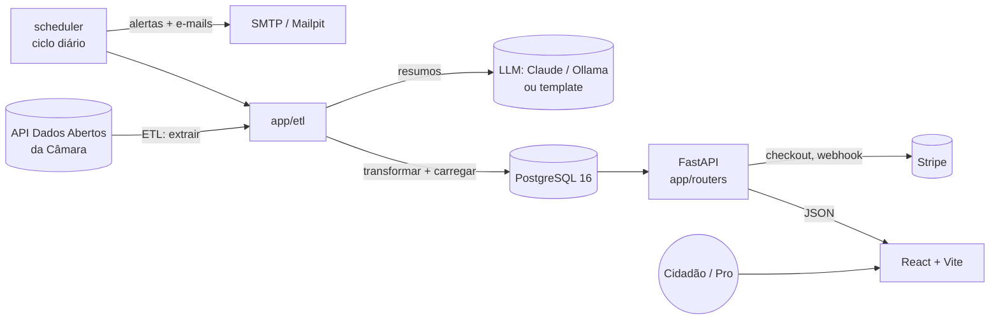
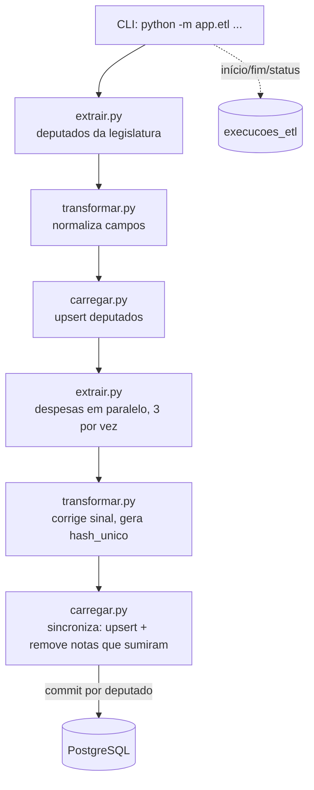
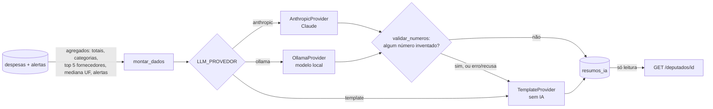
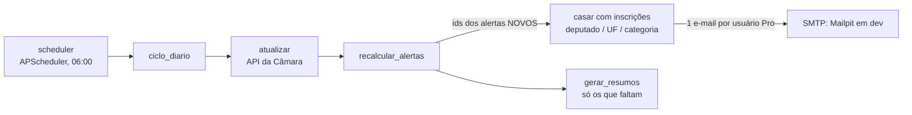

# Arquitetura

## Visão geral



| Camada | Pasta | Responsabilidade |
|---|---|---|
| Coleta (ETL) | `backend/app/etl/` | Buscar dados na Câmara, limpar e gravar no banco |
| Cliente da Câmara | `backend/app/services/camara_client.py` | HTTP com paginação, retry, timeout e pausa |
| Modelo de dados | `backend/app/models/` + `alembic/` | Tabelas e migrações (ver [modelo-dados.md](modelo-dados.md)) |
| API | `backend/app/routers/` | Endpoints REST, documentados em `/docs` |
| Regras de negócio | `backend/app/services/` | Consultas, anomalias, IA, pagamentos, notificações |
| Segurança | `backend/app/seguranca.py` | bcrypt, JWT, dependências de acesso (`exigir_plano_pro`) |
| Agendador | `backend/app/scheduler.py` | Ciclo diário (APScheduler), em processo separado |
| Front-end | `frontend/src/` | Painel público e área do assinante |

## ETL (coleta de dados)



### Comandos

| Comando | O que faz | Tempo aproximado |
|---|---|---|
| `python -m app.etl carga-inicial` | Deputados da legislatura atual e despesas dos últimos 12 meses | ~7 min (+2 min na 1ª vez, para os nomes civis) |
| `python -m app.etl carga-inicial --meses 2 --uf AP` | Recorte pequeno, para testar | ~20 s |
| `python -m app.etl atualizar` | Só o mês atual e o anterior (notas chegam com atraso) | ~1,5 min |

### Fonte de dados: API ou arquivo CSV anual?

A Câmara também publica um arquivo por ano com todas as notas (`https://www.camara.leg.br/cotas/Ano-AAAA.csv.zip`). Comparamos as duas fontes com dados reais (nov/2026):

| Critério | API | CSV anual |
|---|---|---|
| Velocidade da carga inicial | ~4 mil requisições (~7 min) | 2 downloads (~1 min) |
| Categoria "PASSAGEM AÉREA - SIGEPA" | ✅ presente | ❌ **ausente** (~25% das notas na amostra) |
| Sinal do valor líquido | ⚠️ invertido em parte das notas | ✅ correto |

**Decisão:** usar só a API. O CSV deixaria de fora as passagens aéreas, uma das maiores despesas. Os ~7 minutos da carga inicial acontecem uma única vez.

### Peculiaridades da API e como foram tratadas

As peculiaridades abaixo foram encontradas na validação com dados reais, antes de escrever o código:

| Peculiaridade | Tratamento |
|---|---|
| `valorLiquido` vem **negativo** em ~75% das notas (documento R$ 300, líquido −R$ 300), quase sempre nas notas ainda sem `numRessarcimento`. O CSV traz as mesmas notas com valor positivo. | O líquido é calculado como `valorDocumento − valorGlosa`, que tem o sinal correto em todos os casos. |
| Créditos legítimos: passagem cancelada aparece com documento e líquido negativos. | Continuam negativos e abatem o total, que é o comportamento correto. |
| `valorGlosa` pode vir `null`. | Tratado como 0. |
| `codDocumento` é um GUID nas passagens do SIGEPA. | A coluna é texto (migração `cod_documento como texto`). |
| `dataDocumento` pode vir `null` e vem com hora. | Convertida para data; nula quando ausente. |
| Paginação com no máximo 100 itens; pedir mais é ignorado em silêncio. | O cliente sempre pede 100 e segue o link `next`. |
| A legislatura inclui suplentes que já saíram (648 deputados contra 513 em exercício). | Todos são carregados, para não perder despesas de quem exerceu parte do período. A coluna `em_exercicio` diferencia os dois grupos. |

### Idempotência: rodar duas vezes não duplica

- Cada nota recebe um `hash_unico`, um SHA-256 dos campos que a identificam: deputado, mês, categoria, código, número, CNPJ, data, valor e parcela.
- Ficam de fora os campos que a Câmara corrige depois (glosa, líquido). Assim, uma correção **atualiza** a nota em vez de criar outra.
- Notas idênticas em tudo (ex.: duas contas de telefone iguais) recebem um número de ocorrência (`#1`, `#2`), para não serem confundidas com duplicatas.
- A gravação usa o upsert do Postgres (`INSERT … ON CONFLICT DO UPDATE`).
- Para cada deputado e mês baixado, as notas que **não vieram mais** na API são removidas, porque a Câmara às vezes exclui ou corrige notas.

### Respeito à API pública

- Pausa de 0,3 s depois de cada requisição e no máximo 3 downloads simultâneos (`ETL_PAUSA_SEGUNDOS`, `ETL_PARALELISMO`).
- Timeout de 30 s.
- Em erro de rede, 429 ou 5xx: até 5 tentativas, com espera de 1 s, 2 s, 4 s e 8 s.
- Erros 4xx falham na hora, porque repetir não resolveria.
- Se um deputado falhar, o ETL continua com os outros e registra o aviso em `execucoes_etl.erro`.

## API (FastAPI)

```
app/routers/      -> recebem a requisição, validam parâmetros, montam a resposta
app/services/     -> regras e consultas (consultas.py faz as agregações em SQL)
app/schemas/      -> formato do JSON de saída (Pydantic), que também gera o /docs
```

Decisões:

- **As agregações são feitas no banco.** Somas, contagens, medianas (`percentile_cont`) e rankings são calculados com `GROUP BY` no PostgreSQL. Com os índices `(deputado_id, ano, mes)` e `(ano, mes)`, as respostas saem em menos de 200 ms sobre ~180 mil notas, sem cache.
- **Período padrão: últimos 12 meses**, ajustável com `?de=AAAA-MM&ate=AAAA-MM`. Os meses sem gasto aparecem com zero, para os gráficos não pularem meses.
- **Os valores em dinheiro são `Decimal` no Python**, para precisão exata, e saem como número no JSON, para o front não precisar converter.
- **A comparação com a UF usa a mediana, não a média.** Poucos deputados com gasto muito alto puxariam a média para cima.
- **Os rankings por UF e por partido também mostram a média por deputado.** O total favorece grupos grandes (SP tem 70 deputados, RR tem 8). Pela média, as UFs distantes de Brasília aparecem no topo, o que é coerente com a cota maior desses estados.
- **A busca ignora acentos** com a extensão `unaccent` do PostgreSQL: "acacio" encontra "Acácio".
- **O partido é o atual de cada deputado.** A API da Câmara não informa o partido na data de cada nota.

## Front-end (React)

```
src/api/client.ts        -> único ponto de contato com a API (tipos espelham os schemas Pydantic)
src/hooks/useApi.ts      -> busca dados e expõe carregando / erro / dados / recarregar
src/components/          -> peças reutilizáveis (Estado, StatTile, gráficos, busca, paginação)
src/pages/               -> uma página por rota (Home, Deputado, Rankings)
```

- **Todas as telas têm os mesmos estados:** carregando, vazio, erro (com "tentar de novo") e "não encontrado" (404).
- **Os gráficos seguem regras de visualização acessível:**
  - forma escolhida pela função do dado: barras horizontais para comparar categorias, colunas para meses;
  - uma única cor, de uma paleta validada para daltonismo;
  - barras finas, grade discreta e tooltip no hover;
  - botão "ver como tabela" em todo gráfico, para leitor de tela ou para quem quer o número exato.
- **Os filtros dos Rankings ficam na URL** (`/rankings?tipo=uf&ordem=media`): o link pode ser compartilhado e o "voltar" do navegador funciona.
- **A busca espera 300 ms sem digitação** (debounce) e cancela a requisição anterior (`AbortController`), para uma resposta antiga não sobrescrever a nova.
- **O CPF de fornecedor pessoa física aparece parcialmente oculto** (`***.456.789-**`), por cuidado com a LGPD. O CNPJ aparece completo.

## IA: resumos em linguagem simples



- **O que a IA recebe:** só dados agregados, já calculados e já formatados ("R$ 479.861,67", "51%"). Nunca as notas brutas. O modelo não calcula nada, só reescreve em linguagem simples.
- **As regras do prompt:** 3 a 5 frases, tom neutro, sem opinião, sem acusação, só os números fornecidos, a pessoa chamada pelo nome (sem supor gênero) e o vocabulário "fora do padrão/atípico".
- **Conferência automática:** `validar_numeros` extrai todos os números do texto gerado e confere se cada um aparece nos dados. Se aparecer um número inventado (ex.: "cerca de R$ 500 mil"), o texto é descartado e entra o template.
- **Sempre funciona:** sem chave, com erro de rede, limite de requisições ou recusa do modelo, o sistema usa o `TemplateProvider`. O perfil nunca fica sem resumo.
- **Cache:** `python -m app.etl gerar-resumos` gera um resumo por deputado e período e grava em `resumos_ia`. Rodar de novo só gera os que faltam (`--forcar` refaz todos). A API apenas lê do banco, então nenhuma página espera o LLM.
- **Transparência:** o selo do site diz "resumo gerado por IA" só quando um LLM escreveu o texto. Quando foi o template, diz "resumo automático".
- **Configuração do Claude:**
  - modelo `claude-opus-5-5` por padrão (`ANTHROPIC_MODELO`; `claude-haiku-5-5` é bem mais barato para textos curtos);
  - `effort: "low"`, porque a tarefa é simples;
  - fallback no servidor (`fallbacks: "default"`), caso o modelo recuse o pedido;
  - erros tratados com as exceções tipadas do SDK.

## Contas, plano Pro e pagamento

```mermaid
sequenceDiagram
    participant U as Usuário (site)
    participant A as API
    participant S as Stripe
    U->>A: POST /auth/login (e-mail, senha)
    A-->>U: token JWT
    U->>A: GET /export/despesas.csv (Bearer token)
    A-->>U: 403 "exclusivo do plano Pro"
    U->>A: POST /planos/assinar
    alt modo simulado
        A-->>U: plano = pro (30 dias)
    else modo Stripe
        A->>S: cria sessão de checkout
        A-->>U: checkout_url
        U->>S: paga (cartão de teste)
        S->>A: POST /planos/webhook (evento assinado)
        A->>A: confere a assinatura HMAC e ativa o Pro
    end
    U->>A: GET /export/despesas.csv
    A-->>U: 200 (CSV em streaming)
```



- **Senhas:**
  - guardadas só como hash **bcrypt** (lento de propósito e com sal aleatório);
  - o cadastro recusa senhas acima de 72 bytes, o limite do bcrypt;
  - o login devolve a mesma mensagem para "e-mail inexistente" e "senha errada", para não revelar quem tem conta.
- **Token JWT (HS256):** expira em 24 h (`JWT_EXPIRACAO_MINUTOS`). O segredo vem do `.env`, e a API avisa no log se ele ainda for o valor de exemplo.
- **Dependências de acesso (`app/seguranca.py`):**
  - `usuario_opcional` para as rotas públicas;
  - `usuario_atual` responde 401 sem login;
  - `exigir_plano_pro` responde 403 com mensagem clara. Antes de checar, encerra a assinatura simulada se o prazo venceu.
- **Histórico completo:** a dependência de período (`periodo_param`) recusa com 403 os meses anteriores aos últimos 12 para quem não é Pro.
- **Quem confirma o pagamento é o Stripe:** o plano só vira Pro pelo webhook, e o evento tem a assinatura conferida (`construct_event`). Um navegador não consegue se promover a Pro sozinho.
- **Exportação CSV:**
  - feita em streaming (`yield_per=2000`), então 180 mil notas não ficam inteiras na memória;
  - formato para o Excel em português: BOM, `;` e vírgula decimal;
  - CPF de fornecedor pessoa física parcialmente oculto, por cuidado com a LGPD.

## Notificações e agendamento



- **O agendador roda num processo separado** (serviço `scheduler`), não dentro da API. A API pode ter vários processos ou reiniciar no hot-reload, e o job rodaria duplicado ou seria interrompido. Ele usa `max_instances=1` (um ciclo atrasado não começa por cima do outro) e `coalesce=True` (se o computador ficou desligado, roda uma vez só).
- **O ciclo é tolerante a falhas.** Se a API da Câmara estiver fora do ar, as etapas seguintes rodam mesmo assim, com os dados que já existem. Cada etapa registra a própria execução em `execucoes_etl`.
- **"Novo" é definido pela chave estável do alerta** (ver `anomalias.py`). Quem acompanha um deputado e também a categoria dele recebe o alerta uma vez só.
- **Só usuários Pro com inscrição ativa recebem.** Uma falha de envio para um usuário não impede os demais e não desfaz o recálculo.
- **O e-mail tem duas versões:** texto e HTML. O HTML escapa os nomes, e os e-mails longos mostram no máximo 20 alertas, mais um link para o site.
