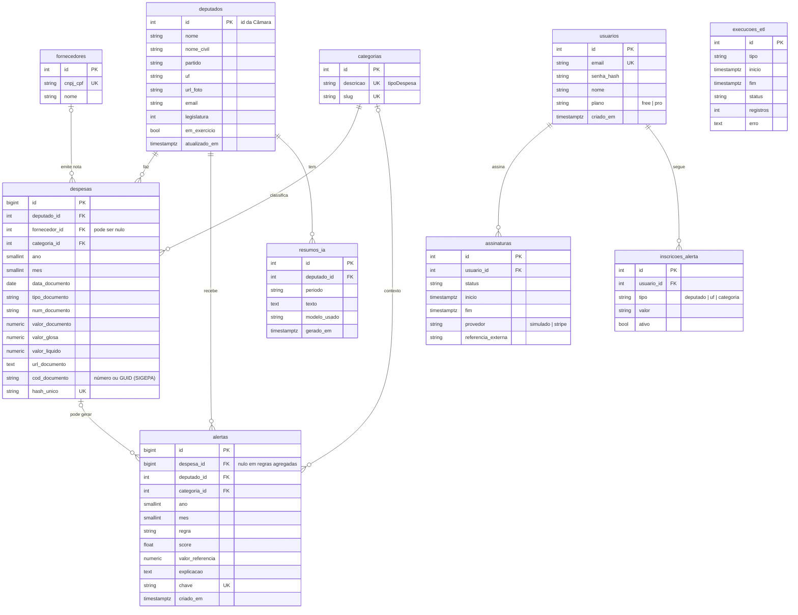

# Modelo de dados

Banco relacional PostgreSQL 16. Todas as tabelas são criadas pelas migrações do Alembic (`backend/alembic/versions/`) a partir dos modelos em `backend/app/models/`.

| Migração | O que faz |
|---|---|
| `esquema_inicial` | Cria as 10 tabelas, chaves, restrições e índices |
| `cod_documento_como_texto` | `despesas.cod_documento` passa de número para texto: a validação com a API real mostrou que as passagens do SIGEPA usam um GUID |
| `extensao_unaccent` | Ativa a extensão `unaccent` do PostgreSQL, para a busca de deputado ignorar acentos |

## Diagrama entidade-relacionamento

## Tabelas

| Tabela | O que guarda | Pontos de atenção |
|---|---|---|
| `deputados` | Deputados da legislatura | A chave primária é o **id da própria Câmara**, sem autoincremento, para o ETL localizar o registro direto. |
| `fornecedores` | Empresas e pessoas que emitiram notas | `cnpj_cpf` é único: a mesma empresa aparece uma vez só. |
| `categorias` | Tipos de despesa da CEAP (combustível, passagens…) | `slug` serve para URLs e filtros. |
| `despesas` | Cada nota fiscal ou recibo reembolsado | `hash_unico` impede duplicatas quando o ETL coleta de novo. Valores em `NUMERIC(12,2)`, exatos em centavos. |
| `alertas` | Gastos fora do padrão encontrados pelas regras estatísticas | Ver a nota abaixo. `chave` única identifica o mesmo achado entre recálculos. |
| `resumos_ia` | Resumo em linguagem simples por deputado e período | Funciona como cache: um por (`deputado_id`, `periodo`). A API só lê, nunca chama o LLM. |
| `usuarios` | Contas do site | Senha guardada só como hash bcrypt. `plano` é `free` ou `pro`. |
| `assinaturas` | Histórico de assinaturas do Pro | `referencia_externa` é o id no Stripe, usado pelo webhook. |
| `inscricoes_alerta` | O que cada usuário Pro "segue" | `valor` = id do deputado, sigla da UF ou slug da categoria. Única por usuário/tipo/valor. |
| `execucoes_etl` | Log de cada execução do ETL | Mostra de quando são os dados e por que uma execução falhou. |

### Nota sobre `alertas`

A especificação original ligava o alerta só a uma despesa (`despesa_id`). Duas das quatro regras, porém, não apontam para uma nota específica:

- **Concentração em fornecedor:** o achado é "o fornecedor X recebeu 60% do gasto de combustível do deputado no período".
- **Gasto mensal total atípico:** o achado é "o total do deputado em outubro".

Por isso a tabela de alertas tem estes ajustes:

- `despesa_id` é **opcional**. Fica preenchido nas regras por nota e nulo nas agregadas.
- `deputado_id`, `categoria_id`, `ano` e `mes` guardam o **contexto** de todo alerta. Isso permite filtrar o feed e casar o alerta com as inscrições (deputado, UF ou categoria) sem consultas complexas.
- `chave` (única) é o **identificador estável** do achado. Recalcular os alertas não cria duplicatas, e é possível saber quais alertas são realmente novos para avisar os inscritos.

### Integridade garantida pelo banco

As regras abaixo ficam no PostgreSQL, não só no código Python. Assim, nem um script com bug consegue gravar dados inválidos:

- **CHECK:** só aceitam os valores válidos de `usuarios.plano`, `assinaturas.status`, `assinaturas.provedor`, `inscricoes_alerta.tipo`, `alertas.regra`, `execucoes_etl.tipo` e `execucoes_etl.status`.
- **UNIQUE:** `despesas.hash_unico`, `usuarios.email`, `fornecedores.cnpj_cpf`, `alertas.chave` e (`deputado_id`, `periodo`) em `resumos_ia`.
- **Chaves estrangeiras:** apagar um usuário apaga em cascata as assinaturas e inscrições dele.

### Índices

| Índice | Atende |
|---|---|
| `despesas (deputado_id, ano, mes)` | Perfil do deputado. Por começar com `deputado_id`, também serve buscas só por deputado. |
| `despesas (ano, mes)` | Visão geral, rankings e recálculo de alertas por período |
| `despesas (categoria_id)`, `despesas (fornecedor_id)` | Filtros por categoria e top fornecedores |
| `deputados (uf)`, `deputados (partido)` | Busca e rankings por UF ou partido |
| `alertas (deputado_id)`, `(categoria_id)`, `(ano, mes)`, `(criado_em)` | Feed de alertas com filtros, ordenado por data |

Os testes em `backend/tests/test_modelo_dados.py` verificam essas regras direto no banco.
